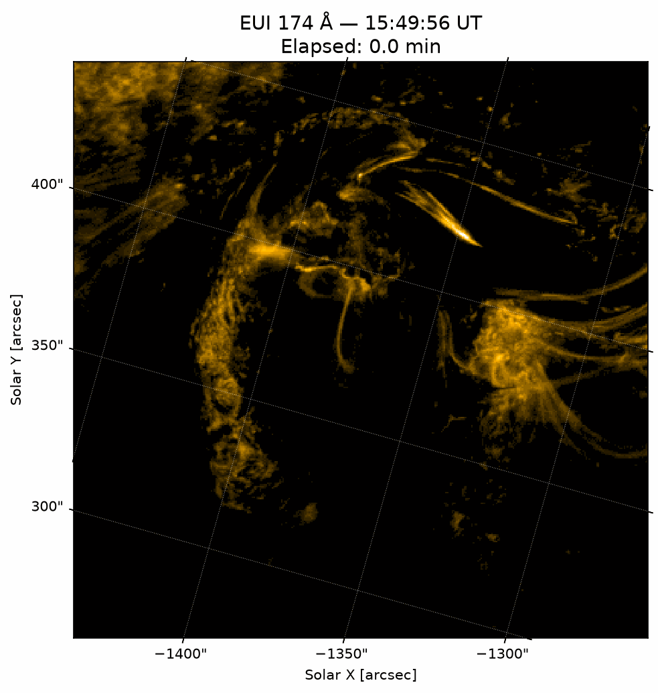

# Fine-Scale Flare Loops with Solar Orbiter/EUI

**Solar Physics Capstone Project**

## Overview

This project measures and analyses the fine-scale structure of flare loops observed by Solar Orbiter's Extreme Ultraviolet Imager (EUI) during the 20 August 2026 solar flare. In particular, it focuses on the widths of individual loop strands, and investigates whether those widths are genuinely resolved by the instrument or limited by its resolution.

<em>Evolution of the post-flare loops in Solar Orbiter/EUI HRIEUV 174 Å observations of the 20 August 2026 flare.</em>

## Weekly Updates

| Week | Report |
|------|--------|
| 1 | [Week 1](week01.md) |
| 2 | [Week 2](week02.md) |
| 3 | [Week 3](week03.md) |
| 4 | [Week 4](week04.md) |
| 5 | [Week 5](week05.md) |
