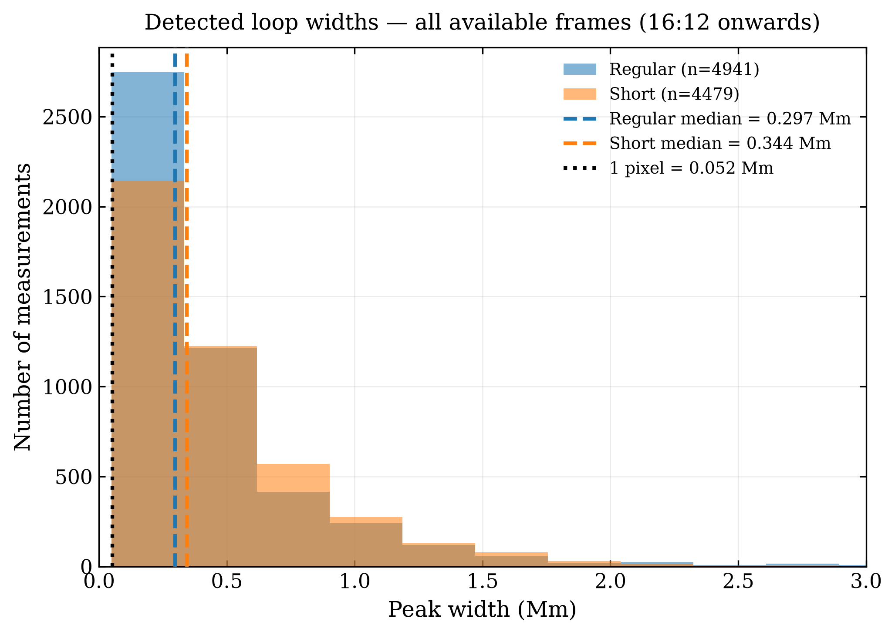
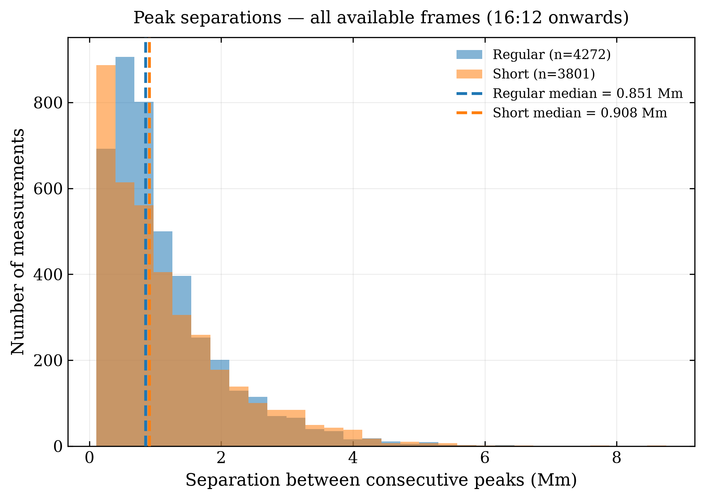
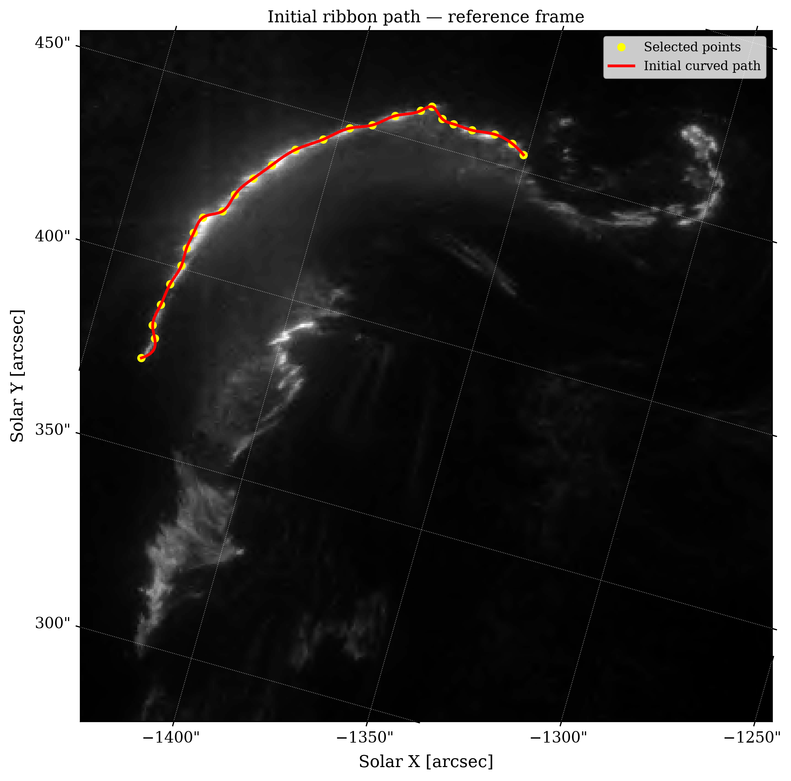
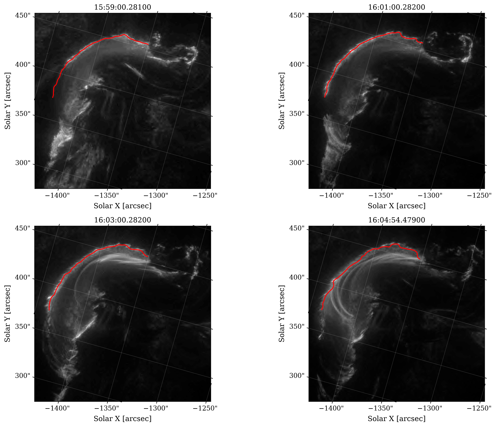

The aim of this week was to get as many loop width and separation measurements as possible, as I had already been working on how to obtain these values for individual frames, and to get the intensity profiles of the pre-arcade ribbon kernels and compare these measurements to those of the loops.

I plotted a histogram of the loop width and separation measurements from 16:12 onwards, as this is when the arcade becomes apparent, and picked a few arbitrary intensity profiles to examine whether the prominence I was using was appropriate. The prominence factor of 0.25 doesn't seem to be overestimating the number of peaks.

Note that for earlier frames (closer to 16:12) the regular_exposure images are saturated, so although they aren't as well resolved and don't capture the smallest of widths in later frames, they avoid taking extremely large widths for early frames when the regular exposures are saturated.

When trying to get the ribbon kernel slicing for multiple frames, I was met with the issue that the structure moves between successive frames, so I can't fix a slice like I had been doing for the arcade, but manually picking the slice would have been too time consuming. With the help of AI, I wrote code that automatically finds the slice for all frames by using a reference slice that I had manually provided for the 16:00 frame which clearly shows the structure, and using the code to look for the brightest pixels within 5 pixels of that reference slice for all other frames.

This was done for all available slices between 15:59 and 16:05, and the histograms have very similar shapes to those for the loop widths and separations.

